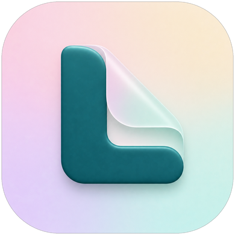
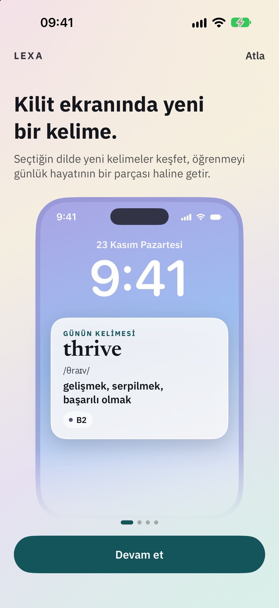
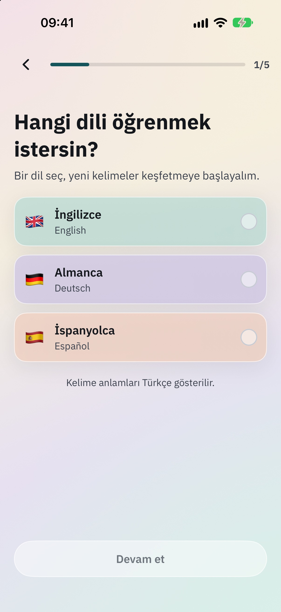
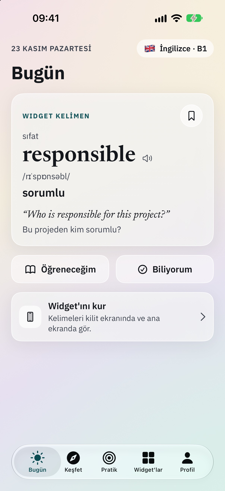
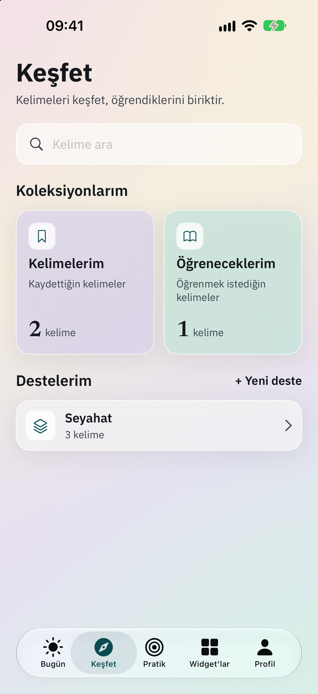
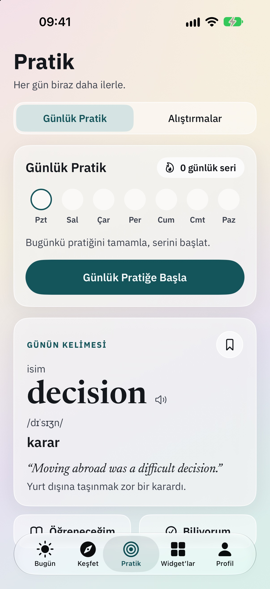
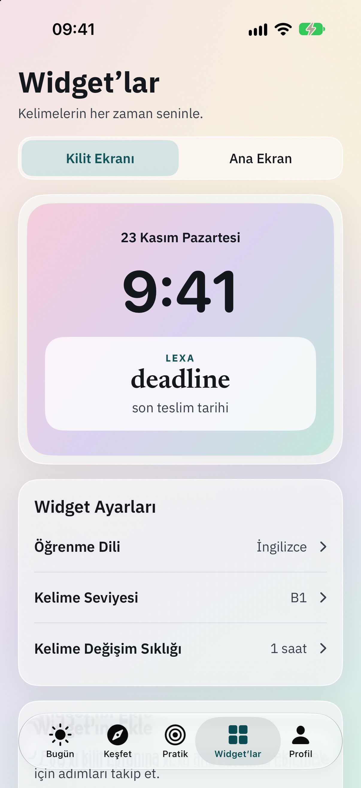

# LEXA — Widget ile kelime öğren



LEXA, kelimeleri kilit ekranına ve ana ekrana taşıyan bir iOS kelime öğrenme uygulamasıdır. Kullanıcı öğrenmek istediği dili ve seviyesini seçer; uygulama seçilen sıklıkta yeni bir kelime gösterir, kısa pratiklerle tekrar ettirir.

- **Platform:** iOS 17+ (iPhone)
- **Teknoloji:** SwiftUI, MVVM, WidgetKit, Firebase (Auth + Firestore)
- **Diller:** İngilizce, Almanca, İspanyolca → anlamlar Türkçe
- **Tasarım kaynağı:** Open Design prototipi (`Figmada-Açma-Talebi`)

<p>
  
  
  
  
  
  
</p>

---

## Özellikler

| Ekran | Ne yapar |
|---|---|
| **Tanıtım** | 4 slaytlık tanıtım + Giriş yap / Hesap oluştur / Hesapsız devam |
| **Kurulum (5 adım)** | Dil → Seviye (A1–C2) → Amaç (IELTS/TOEFL dahil) → Kelime sıklığı → Hatırlatıcı |
| **Bugün** | Günün kelimesi kartı; sağa kaydır = *Biliyorum*, sola = *Öğreneceğim*, yer imi, sesli okunuş |
| **Keşfet** | Kelime arama (yerel + çevrim içi sözlük), Kelimelerim / Öğreneceklerim koleksiyonları, kendi destelerin ve flashcard çalışması |
| **Pratik** | 5 soruluk *Günlük Pratik* (seri takibi) + 10 adımlı *Alıştırmalar* yolu (15 soru, geçme notu 12) |
| **Widget’lar** | Kilit / ana ekran önizlemesi, widget ayarları, kurulum rehberi |
| **Profil** | Hesap, öğrenme tercihleri, bildirimler, yardım (SSS), hakkında |
| **Widget eklentisi** | Kilit ekranı (dikdörtgen, satır içi) ve ana ekran (küçük, orta) |

---

## Kurulum ve çalıştırma

Gereksinimler: Xcode 26+, Homebrew.

```bash
brew install xcodegen      # bir kez
xcodegen generate          # project.yml → Lexa.xcodeproj
open Lexa.xcodeproj        # "Lexa" şemasını seç, ⌘R
```

> `Lexa.xcodeproj` dosyası `project.yml`'den üretilir. Yeni dosya eklediğinde `xcodegen generate` komutunu tekrar çalıştır.

**Gerçek cihazda çalıştırmak için:** Xcode → *Signing & Capabilities* → her iki hedefte (Lexa, LexaWidget) kendi **Team**'ini seç. Widget'ın uygulamayla veri paylaşması `group.com.lexa-learning.app` App Group'una bağlıdır.

---

## Mimari

**MVVM + bileşen yapısı.** Her ekran bir `View` ve bir `ViewModel`'den oluşur; ortak arayüz parçaları `Components` altındadır.

```
Lexa/
├── App/
│   ├── LexaApp.swift         Giriş noktası, Firebase yapılandırması
│   ├── RootView.swift        Faz yönlendirme (tanıtım → kurulum → ana uygulama) + sekmeler
│   ├── AppState.swift        Tek doğruluk kaynağı: kullanıcı verisi, kalıcılık, senkron
│   └── DebugLaunch.swift     QA başlatma parametreleri (yalnızca Debug)
├── Core/
│   ├── DesignSystem/         Renk & font token'ları, pastel zemin, cam kart, buton stilleri
│   │   └── Components/       ChoiceCard, SegmentedTabs, SettingRow, StepProgressBar, LevelTag, Toast…
│   ├── Models/               Word, UserData, Deck, LearningOptions, QuizQuestion
│   └── Services/             AuthService, UserRepository, DictionaryService,
│                             WordRepository, Speech/Notification, WidgetBridge
├── Features/
│   ├── Landing/  Auth/  Onboarding/  Today/
│   └── Explore/  Practice/  Widgets/  Profile/
└── Resources/                words.json, fontlar, Assets, GoogleService-Info.plist
LexaWidget/                   WidgetKit eklentisi
Shared/                       Uygulama + widget ortak kodu (renkler, WidgetSnapshot)
```

| Katman | Sorumluluk |
|---|---|
| **View** | Yalnızca çizim ve kullanıcı etkileşimi |
| **ViewModel** (`@Observable`) | Ekran mantığı, doğrulama, akış |
| **AppState** | Kullanıcı verisi, yerel kayıt, Firestore senkronu, widget güncellemesi |
| **Services** | Dış dünya: Firebase, sözlük API'leri, bildirim, ses |

**Veri akışı:** Misafir kullanıcının verisi cihazda tutulur. Hesap açınca bu ilerleme Firestore'a taşınır (`users/{uid}`, kullanıcı başına tek doküman). Ardışık değişiklikler 1,5 sn içinde tek yazmada birleştirilir.

**Tasarım token'ları** prototipin `:root` değişkenlerinden alınmıştır (açık/koyu mod): ana renk `#14555C`, kelimeler için *Newsreader*, arayüz için *IBM Plex Sans*.

---

## Veri kaynakları

Hepsi ücretsizdir ve API anahtarı gerektirmez.

| Kaynak | Nerede | Not |
|---|---|---|
| Kelime seti — [`lexa-learning.web.app/words/v1.json`](https://lexa-learning.web.app/words/v1.json) (Firebase Hosting) | Bugün, Pratik, Widget | Açılışta indirilir, cihaza kaydedilir; değişmediyse tekrar indirilmez (ETag). İnternet yokken cihazdaki kopya, o da yoksa uygulamadaki yedek (`Lexa/Resources/words.json`) kullanılır |
| [Free Dictionary API](https://dictionaryapi.dev/) | Keşfet araması (İngilizce) | Okunuş, kelime türü, örnek cümle; ~0,4 sn |
| [MyMemory](https://mymemory.translated.net/) | Keşfet araması (EN/DE/ES → TR) | Anonim kota günde ~5.000 karakter |
| [Kaikki.org](https://kaikki.org/) | — | Gerçek zamanlı API değil; ileride `words.json`'ı büyütmek için |

**Kelime ekleme / düzeltme (App Store güncellemesi gerekmez):** `hosting/words/v1.json` dosyasını düzenle, sonra `firebase deploy --only hosting` çalıştır. Kullanıcılar yeni seti bir sonraki açılışta alır. Dosyanın yapısı değişirse `v2.json` olarak yayınla; eski uygulama sürümleri `v1.json`'ı okumaya devam eder.

Arama önce yerel listeye bakar; tam eşleşme yoksa 400 ms sonra iki API'ye paralel istek atar ve sonucu önbelleğe alır.

---

## Firebase

Proje: **lexa-learning** · Plan: **Spark (ücretsiz)**

| Servis | Durum |
|---|---|
| Authentication — e-posta/şifre | ✅ Açık |
| Cloud Firestore — `(default)`, `eur3` | ✅ Oluşturuldu |
| Güvenlik kuralları (`firestore.rules`) | ✅ Yüklendi ve test edildi |

Kurallar: kullanıcı yalnızca kendi `users/{uid}` dokümanını okuyup yazabilir; izin listesinde olmayan alanlar reddedilir.

Kuralları değiştirdikten sonra yüklemek için:

```bash
firebase login
firebase deploy --only firestore,auth --project lexa-learning
```

---

## Test

### Demo modu (yalnızca Debug derleme)

Uygulamayı örnek verilerle doğrudan istenen ekranda açar:

```bash
xcrun simctl launch booted com.lexa-learning.app -lexaDemo today      # today | explore | practice | drills | done | widgets | profile
xcrun simctl launch booted com.lexa-learning.app -lexaOnboarding 0    # kurulum akışı
```

`done` → bugünkü pratiği tamamlanmış hâliyle açar.

### Elle test edilmesi gerekenler

- [ ] Hesap oluştur → Firestore'da `users/{uid}` dokümanı oluşuyor mu?
- [ ] Misafirken kaydedilen kelimeler hesap açınca korunuyor mu?
- [ ] Çıkış yap → tekrar giriş → veriler geri geliyor mu?
- [ ] Şifre sıfırlama e-postası geliyor mu?
- [ ] Günlük pratik: 5 soru, sonuç ekranı, seri artışı
- [ ] Alıştırma: 12+ doğruda sonraki adım açılıyor mu, 11 ve altında "Tekrar Dene"
- [ ] Keşfet araması: yerel sonuç, çevrim içi sonuç, internet kapalıyken hata mesajı
- [ ] Bildirim izni: ver / reddet / Ayarlar'dan geri aç
- [ ] Widget: kilit ekranı ve ana ekrana ekle, seçilen sıklıkta kelime değişiyor mu?
- [ ] Koyu mod ve büyük yazı boyutu (Dynamic Type)

---

## Açık konular

- **Destek e-postası:** `lexalearning01@gmail.com` (`Lexa/Features/Profile/SettingsScreens.swift` ve Firebase Hosting sayfaları).
- **Kelime listesi:** 164 kelime başlangıç için; Kaikki verisiyle genişletilebilir.
- **MyMemory kotası:** Kullanıcı sayısı artarsa `de=<e-posta>` parametresiyle günlük kota 50.000 karaktere çıkarılabilir.

---

## Lisanslar

- Yazı tipleri: [Newsreader](https://fonts.google.com/specimen/Newsreader), [IBM Plex Sans](https://fonts.google.com/specimen/IBM+Plex+Sans) — SIL Open Font License (`Lexa/Resources/Fonts/OFL-*.txt`)
- Sözlük verileri: Free Dictionary API, MyMemory
